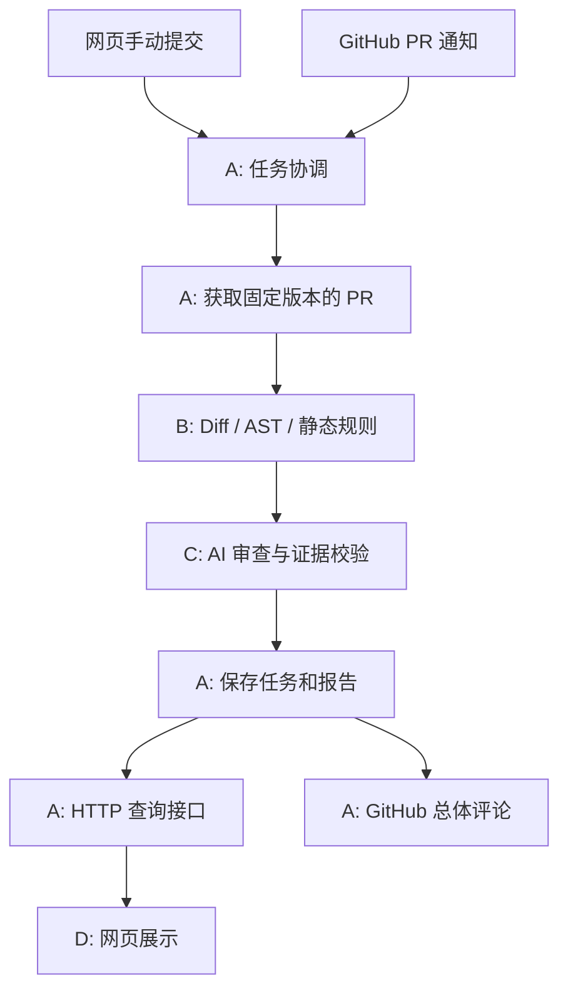

# 架构概览

更新：2026-10-25。先读 [项目需求](requirements.md)，再按本文找到自己的开发位置。

## 1. 系统由什么组成

CodeRisk 有一个浏览器网页和一个 Python 后端。后端内部按职责划分模块，在同一个应用中运行，通过函数调用合作。
GitHub 保存代码并发出 PR 通知，后端获取数据、组织分析、保存结果，再供网页查看或回写评论。不需要桌面客户端。



图为目标流程，尚未完整实现。A 负责调用 B 和 C；B 不直接调用 C，C 不负责存库或发评论，D 不直接访问数据库。
手动提交与自动事件共用同一套后台流程。

## 2. 目前哪些已经可以运行

已有 FastAPI 入口、健康检查、环境配置、日志和统一错误；公共模型和接口约定已经定义。
网页可以展示一个固定 Mock 任务及报告，后端有基础与 GitHub 适配器离线测试，仓库有 CI 和 Docker 配置。

A-01 已提供独立的 [GitHub 快照适配器](a01-github-fetch.md)，尚未装配到 HTTP 流程；
任务协调器、数据库、Diff/AST 和 LLM 仍未实现。合法提交请求仍返回 501；关闭 Mock 后查询返回 503，不会自动启用真实服务。
Docker 配置尚未完成启动实测，完整业务和浏览器 E2E 仍待实现。现有测试不代表这些业务已验证。

## 3. 当前文件分别做什么

以下路径均相对仓库根目录。组员先找自己的角色文档，再按需阅读公共文件。

| 位置 | 作用 | 主要维护者 |
|---|---|---|
| `backend/app/main.py` | 创建 FastAPI、装配依赖、注册日志/错误/路由；当前装配 Mock | A，C 协调跨模块变更 |
| `backend/app/api/routes/reviews.py` | HTTP 校验和任务/报告入口，调用内部服务 | A |
| `backend/app/core/config.py` | Settings、环境读取与日志配置 | A；C 补模型配置 |
| `backend/app/core/errors.py` | 可安全向调用方展示的公共模块异常 | C 协调，全员使用 |
| `backend/app/schemas/models.py` | 模块之间交换的数据结构及校验 | C 协调，消费方共同 Review |
| `backend/app/services/contracts.py` | 模块方法和输入输出的 Protocol 约定 | C 协调，各实现者维护 |
| `backend/app/services/mock_store.py` | 固定示例，只供联调，不是持久化适配器 | A/D |
| `backend/tests/` | 各模块及接口测试 | 作者写自己模块测试，D 补集成 |
| `frontend/src/main.tsx`、`style.css` | 当前页面、简单导航和样式 | D |
| `frontend/src/api.ts` | HTTP client 与当前展示用 TS 类型 | D，与 A/C 核对 |
| `frontend/vite.config.ts` | 开发代理，将 /api 转发给后端 | D |
| `backend/pyproject.toml`、两端锁文件 | 依赖、pytest、Ruff、构建与类型检查 | 相关作者修改，C/D 协调 |
| `.github/`、Dockerfile、Compose | 协作模板、CI、开发容器配置 | D 牵头，全员配合 |

main.py 只做装配，路由只处理 HTTP；不要把解析器或提示词逻辑放进它们。
当前页面请求实际走 `api.ts → reviews.py → MockReadStore → JSON → 页面`。

## 4. 业务开始实现时再创建的目录

下面是建议落点，当前尚不存在。内部文件名可以调整，公共接口需要共同评审。

```text
backend/app/
├── integrations/github.py       A：GitHub 请求
├── api/routes/webhooks.py       A：Webhook 验签与事件入口
├── services/coordinator.py      A：串联各模块
├── db/sqlite.py                 A：任务、快照和报告存储
├── analyzers/                   B：diff.py、python_ast.py、rules.py、analyzer.py
└── reviewers/                   C：provider.py、prompts.py、ai_reviewer.py

frontend/src/
├── pages/                      D：列表/提交、详情、历史
└── components/                 D：共享状态和报告展示组件
```

不要为填满目录创建空模块。每人的文件、任务和测试见 [A](roles/a-backend-github.md)、[B](roles/b-code-analysis.md)、[C](roles/c-ai-review.md)、[D](roles/d-frontend-testing.md)。

## 5. 为什么这样组织

- 模块化单体：四人分别开发，一个后端容易启动与集成。
- Pydantic 模型：交换数据时能检查格式；不能证明风险判断正确。
- Protocol：约定调用方式，可用 fake 独立测试；不会自动产生业务实现。
- 依赖注入：把 analyzer/reviewer 等对象传给协调器，不让模块依赖彼此内部实现。
- SQLite、单进程后台任务：首版计划采用的简单方案，仍需实现事务与重启恢复。

暂不引入任务队列、微服务或完整语义图。重要选择和待确认细则集中在 [决策记录](decisions.md)，公共数据与调用规则见 [接口约定](interfaces.md)。
