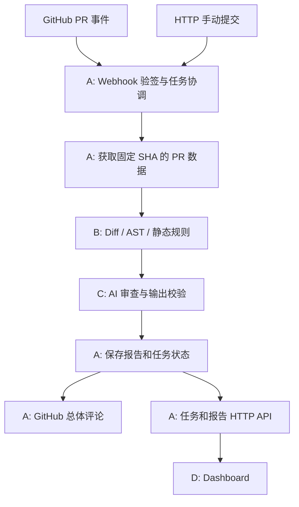

# CodeRisk 团队开发指南

本文统一解释架构、接口、职责、任务和验收，供 A/B/C/D 在现有框架上独立开发。
README 只保留安装与入口；不再维护平行版本的任务计划、接口说明或开发规范。
接口的最终依据是代码中的 Pydantic 模型与 Protocol。修改它们时必须同步更新本文。

## 阅读方式与角色

第一次参与项目：先读第 1–5 节，再读自己的角色章节，最后看第 10–13 节的联调、计划和协作要求。

| 角色 | 主责 | 一句话目标 | 重点阅读 |
|---|---|---|---|
| A | 后端 + GitHub 集成 | 接上 GitHub，把各模块组织起来，保存并发布报告 | [A 的任务](#role-a) |
| B | 代码分析 | 准确说明改动发生在哪里、改了什么、有哪些静态证据 | [B 的任务](#role-b) |
| C | AI 审查 + 架构协调 | 根据变更与已有证据生成有用、可信的候选审查意见 | [C 的任务](#role-c) |
| D | 前端 + 集成测试 + 部署 | 展示任务与报告，验证整条系统链路可以稳定运行 | [D 的任务](#role-d) |

C 对应项目负责人，同时协调公共模型、接口、架构决策和进度。
每人负责自己模块的单元测试。D 的测试职责是跨模块集成、浏览器 E2E 与部署验证，不代写全组单元测试。
本文 P0 表示最小闭环必需，P1 表示闭环后的增强；任务先后按依赖调整，不是固定周次承诺。

快速跳转：[当前架构](#architecture) · [文件归属](#files) · [数据模型](#data) · [Python 接口](#contracts) ·
[HTTP](#http) · [可运行示例](#examples) · [联调验收](#integration) · [五周参考](#plan) · [协作约定](#collaboration)。

<a id="architecture"></a>

## 1. 先分清：现在有什么，最终要做什么

### 1.1 当前已经可以运行的部分

| 部分 | 实际行为 | 后续维护 |
|---|---|---|
| FastAPI 应用、配置、日志、统一错误 | 可启动，产生 request_id，读取环境变量 | A；公共约定由 C 协调 |
| Pydantic 模型与 Protocol | 可校验数据、说明模块调用方式；没有真实业务实现 | C 协调，全员遵守 |
| `/health` | 返回后端存活状态和 mock/unconfigured 模式 | A |
| 任务/报告 GET | 返回一个固定的 `is_mock=true` 示例 | A 替换数据来源，D 对接 |
| `POST /api/v1/reviews` | 合法请求返回 501，不创建任务 | A |
| React/TypeScript 页面 | 可查看 Mock 列表、报告与历史入口；统计是占位 | D |
| pytest / Ruff / CI 配置 | 后端有 15 个基础用例；CI 定义后端检查与前端构建 | 各模块作者；D 集成维护 |
| Dockerfile / Compose | 已提供开发启动配置，未完成容器构建与启动实测 | D |

当前 `MockReadStore` 不是数据库，也没有执行 GitHub 请求、代码分析或模型调用。
关闭 Mock 只会让相关 GET 返回 503，不会自动切换到真实业务。
现有测试不代表尚未实现的业务已经验证；远程 CI 状态以对应提交的 Actions 结果为准。

### 1.2 最终的一次审查如何流动（待实现）



A 的协调器是调用者。B 不调用 C，C 不调用 GitHub，D 不直接访问数据库。
后台模块在同一个 Python 应用中运行，通过函数调用合作；不拆微服务，不引入 Redis/Celery。
前端在浏览器中运行，通过 HTTP 与后端通信。

举例：PR 修改 `src/payment.py`。A 获取该文件 Diff 和对应提交的内容；B 找到受影响函数及静态发现；
C 读取这些证据生成报告；A 保存并发布；D 展示文件位置、证据、原因与建议。

### 1.3 初次阅读时会遇到的术语

| 术语 | 在项目中的含义 |
|---|---|
| Diff / hunk | 修改前后的差异文本 / 一段带行号的变更块，不是完整文件 |
| AST | Python 代码解析后的结构树，用于识别函数和语句；解析不等于运行 |
| Webhook | GitHub 在事件发生时向后端发 HTTP 请求；后端需验证请求来源 |
| Schema / DTO | 数据结构与传输对象；这里主要指 Pydantic 模型和 TS 对应类型 |
| Protocol | Python 类型接口，约定模块有哪些方法，不提供真实业务实现 |
| 依赖注入 | 创建协调器时把 analyzer/reviewer 等对象传进去，便于换真实实现或 fake |
| async | 允许网络等等待操作让出执行机会；不自动把 CPU 分析变快，也不自动后台运行 |
| fixture / fake / Mock | 固定测试数据 / 可替换服务的简化实现 / 模拟数据或行为；用途必须标清 |
| 幂等 / upsert | 重复事件不会重复产生同一副作用 / 已有记录更新、不存在则新增 |
| E2E | 从输入到页面/输出的整条路径测试，不能只测试一个函数就声称全链路通过 |

当前一次页面请求的真实路径是 `frontend/src/api.ts → reviews.py → MockReadStore → JSON → 页面`。
`main.py` 负责把这些部分装配到 FastAPI；未来 A 在这里或独立装配函数中接入真实依赖。

<a id="files"></a>

## 2. 目录和文件：谁应该改哪里

### 2.1 当前实际存在的工程部分

| 路径 | 内容与作用 | 主要修改者 | 开发注意 |
|---|---|---|---|
| `backend/app/main.py` | 创建应用、注册路由/异常处理/请求日志，当前装配 Mock | A，C 协调跨模块装配 | 不放 Diff 或提示词逻辑 |
| `backend/app/api/routes/reviews.py` | HTTP 参数校验、查询和提交入口 | A | 路由调用服务，不承担完整业务流程 |
| `backend/app/core/config.py` | Settings 和日志配置 | A；C 添加模型配置 | 新配置同步 `.env.example`，凭证用 SecretStr 等安全类型 |
| `backend/app/core/errors.py` | `ModuleError` 公共异常 | C 协调，A/B/C 使用 | message 必须可安全对外展示 |
| `backend/app/schemas/models.py` | 模块间交换的全部公共 Pydantic 模型 | C 协调，全员评审相关字段 | 不各写一套同名 DTO |
| `backend/app/services/contracts.py` | GitHub、分析、AI、存储、协调器的 Protocol | C 协调，各实现者共同维护 | 定义类型签名，不是已实现的服务 |
| `backend/app/services/mock_store.py` | 一个只读示例任务和报告 | A/D 联调时使用 | 不把它扩充成真实数据库 |
| `backend/tests/test_foundation.py` | 健康、Mock、Schema、错误等基础测试 | C 协调，A 维护 HTTP 行为 | 业务实现后补充测试，不能删除失败断言来“通过” |
| `backend/pyproject.toml` | Python 依赖、pytest、Ruff 配置 | 改动相关依赖的成员，C Review | 新增依赖应说明必要性 |
| `backend/requirements-dev.lock` | 已固定版本的依赖清单 | C 协调，D 验证安装 | 包含开发工具；不得写个人 editable 绝对路径 |
| `frontend/src/main.tsx` | 当前全部页面和简单导航 | D | 页面增多后拆 pages/components，不预先堆空目录 |
| `frontend/src/api.ts` | HTTP client 和当前展示用 TypeScript 类型 | D，与 A/C 核对 | 当前只是模型字段子集，后续补齐失败/诊断字段 |
| `frontend/src/style.css` | 基础样式 | D | 先保证信息可读，不追求复杂 UI |
| `frontend/vite.config.ts` | 开发代理到后端 | D | 默认同机 8000，Compose 使用服务名 |
| `frontend/package*.json`、`tsconfig.json` | npm 依赖锁、命令与类型检查 | D | 使用 npm ci 复现安装 |
| `.github/workflows/ci.yml` | 后端 lint/format/test 和前端 build | D，各作者修自己的失败 | 默认不调用真实外部 API |
| `.github/ISSUE_TEMPLATE/`、PR 模板 | 领取任务、报告缺陷、说明验证 | 全员 | 任务 ID 与本文对应 |
| Dockerfile、`.dockerignore`、Compose | 开发容器与服务启动 | D，与 A 确认数据目录 | 当前前端是开发服务器，不直接用于公网生产 |
| `.env.example`、`.gitignore` | 配置示例、排除密钥与本地产物 | A/C/D 按需维护 | `.env.example` 可提交，真实 `.env` 不提交 |

### 2.2 有实现时再创建的目录和建议文件

这些路径目前不存在。它们是落点建议，成员可以在职责范围内调整内部文件名，不必提前建满。

```text
backend/app/
  integrations/github.py       A：GitHubGateway 实现
  api/routes/webhooks.py       A：原始字节验签与事件接收
  services/coordinator.py      A：ReviewCoordinator 实现
  db/sqlite.py                 A：ReviewRepository 实现
  analyzers/diff.py            B：unified diff 解析
  analyzers/python_ast.py      B：AST 函数定位
  analyzers/rules.py           B：少量静态规则
  analyzers/analyzer.py        B：统一 CodeAnalyzer 入口
  reviewers/ai_reviewer.py     C：统一 AIReviewer 入口
  reviewers/provider.py        C：LLM 网络适配器
  reviewers/prompts.py         C：提示词与上下文整理
backend/tests/
  fixtures/                   A/B/C 共同维护合成 PR 与标注样例
  test_github.py               A：外部请求的离线测试
  test_coordinator.py          A：状态、调用顺序、失败与幂等
  test_analyzer.py             B：解析、定位、规则
  test_reviewer.py             C：模型输出与证据校验
  test_integration.py          D：跨模块链路，各作者协助修复
frontend/src/
  pages/                      D：任务列表、详情、历史
  components/                 D：报告、问题、状态等共享显示
```

每个成员的模块依赖公共 Schema 和 Protocol。禁止为了复用而直接导入另一成员的内部解析器、提示词或 SQL 实现。
应用装配层可以导入具体实现，再将它们传入协调器，这是正常的依赖注入。

<a id="data"></a>

## 3. 公共数据：每个模块交付什么

代码依据：[models.py](../backend/app/schemas/models.py)。下表不是数据库表设计，而是 Python 模块与 API 交换的数据结构。
`?` 表示可选/可为 None；集合默认值以代码为准。Schema 拒绝未知字段（extra=forbid）。

| 模型 | 主要字段与含义 | 填写者 → 消费者 |
|---|---|---|
| `CreateReviewRequest` | `repository=owner/repo`、`pr_number>0` | HTTP 调用方 → A |
| `PullRequestData` | repository、number、title、base/head_ref、base/head_sha、files、fetched_at | A → B/C |
| `ChangedFile` | path、previous_path?、status、patch?、patch_truncated、old/new_content? | A → B/C |
| `ChangedFunction` | qualified_name、location、context | B → C |
| `AnalysisResult` | head_sha、status、functions、findings、diagnostics | B → A/C |
| `Finding` | category、severity、location、reason、evidence、suggestion、source、rule_id? | B 静态 / C AI → 报告/A/D |
| `SourceLocation` | path、side、start_line、end_line | B/C → A/D |
| `Diagnostic` | code、message、path?，描述分析限制或处理问题 | B/C → A/D |
| `ReviewTask` | id、repository、pr_number、head_sha、status、publication_status、error?、created_at、is_mock | A → D |
| `ReviewReport` | task_id、head_sha、status、summary、findings、diagnostics、error?、is_mock、generated_at | C；上游失败由 A 组装 → A/D |
| `ErrorDetail` / `ErrorResponse` | code、message、retryable；HTTP 外层加 request_id | 模块/A → 调用方/D |
| `TaskList` | items、total、limit、offset | A → D |

### 3.1 Task、Report、Finding、Diagnostic 的区别

- Task：一次工作的状态；排队时也必须能查到。
- Report：一次工作的结果；生成前不应该伪造空成功报告。
- Finding：与具体代码位置关联的候选问题，需要证据、原因和建议。
- Diagnostic：处理限制，例如 Diff 缺失或文件语法错误；不是代码存在风险的断言。

`findings=[]` 只表示没有报告发现，不能显示成“代码安全”。分析失败也不能只返回空 findings 隐藏失败。

### 3.2 快照、路径和行号必须统一

1. base_sha/head_sha 是 40 位小写十六进制提交 SHA；任务和报告必须绑定同一 head_sha，不用分支名代替。
2. A 在固定 SHA 获取 Diff 与文件全文。PR 更新后是新快照，不把新内容与旧 Diff 混用。
3. path 是仓库相对 POSIX 路径，例如 `src/payment.py`，不带 `a/`、`b/`、盘符、绝对目录或 `..`。
4. 行号从 1 开始，范围含两端；`side=new` 对应 head，`side=old` 对应 base。
5. 删除行使用 old；重命名文件在 old 侧使用 previous_path。文件范围无法确定时写诊断，不伪造 0 行或新侧第 1 行。
6. patch 是文件级 unified diff。None 表示不可用，不能解释为零改动；截断需要标记。
7. old/new_content 是供静态解析的文本。全文可缺失，A 说明限制，B 返回诊断；不能把 patch 当作完整 Python 文件。
8. 时间由模块使用带时区的 UTC 生成；当前 Schema 并未全面禁止外部传入无时区时间，A/C 应在实现时保持该约定。

### 3.3 状态与报告约定

| 对象/字段 | 值 | 解释 |
|---|---|---|
| ReviewTask.status | queued / running / completed / failed | 任务处理状态 |
| AnalysisResult.status | complete / partial / failed | 全部可处理 / 部分受限 / 整体失败 |
| ReviewReport.status | completed / failed | 最终审查结果；failed 必须有 error，completed 禁止有 error |
| publication_status | not_requested / pending / published / failed | GitHub 评论发布状态，与审查状态分开 |
| severity | low / medium / high / critical | 候选问题严重程度 |
| Finding.source | static / ai | B 的规则发现 / C 的 AI 发现 |
| is_mock | true / false | true 结果仅用于联调，不得冒充真实审查 |

任务状态转换、Task 与 Report 的一致性并非全部由 Pydantic 自动保证，A 的服务和存储测试需要检查。
AI 成功而评论发布失败时，任务仍可 completed，同时 publication_status=failed；页面要说明是哪一步失败。

<a id="contracts"></a>

## 4. 模块接口：按照哪些方法开发

代码依据：[contracts.py](../backend/app/services/contracts.py)。Protocol 是类型约定，不会自动产生实现或替开发者执行流程。
无需为了符合 Protocol 建复杂继承体系，实现相同方法签名并通过测试即可。
以下签名是接口摘录，所需类型从 models 导入，Protocol 从 typing 导入，UUID 从 uuid 导入。

### 4.1 A 的 GitHub 和协调器

```python
class GitHubGateway(Protocol):
    async def fetch_pull_request(self, repository: str, number: int) -> PullRequestData: ...
    async def publish_report(self, pr: PullRequestData, report: ReviewReport) -> str: ...

class ReviewCoordinator(Protocol):
    async def submit(self, request: CreateReviewRequest) -> ReviewTask: ...
    async def run(self, task_id: UUID) -> None: ...
```

submit 获取 PR 快照并原子创建 queued 任务，重复快照返回原任务。run 执行已创建任务，保存结果与状态。
publish_report 返回评论 URL，使用稳定的 task/head 标记查询并更新总体评论。
当前没有这些具体实现，也未把它们接到 HTTP 路由。

### 4.2 B 的分析器和 C 的 Reviewer

```python
class CodeAnalyzer(Protocol):
    def analyze(self, pr: PullRequestData) -> AnalysisResult: ...

class AIReviewer(Protocol):
    async def review(
        self, task_id: UUID, pr: PullRequestData, analysis: AnalysisResult
    ) -> ReviewReport: ...
```

B 的方法是同步本地分析，不访问 GitHub/LLM、不写库。A 将 CPU/同步阻塞分析放到线程中执行，避免阻塞事件循环。
C 的方法是异步，因为涉及模型网络请求。C 不取 PR、不创建任务、不存库、不发布评论。
C 保留 B 的静态发现，对重复项去重，不让模型无依据删除静态证据。

### 4.3 A 的存储

```python
class ReviewRepository(Protocol):
    async def create_if_absent(self, task: ReviewTask) -> tuple[ReviewTask, bool]: ...
    async def get_task(self, task_id: UUID) -> ReviewTask | None: ...
    async def list_tasks(self, limit: int, offset: int) -> TaskList: ...
    async def save_task(self, task: ReviewTask) -> None: ...
    async def save_report(self, report: ReviewReport) -> None: ...
    async def get_report(self, task_id: UUID) -> ReviewReport | None: ...
```

首版计划使用标准库 sqlite3。repository 标识规范化后，以 `(repository, pr_number, head_sha)` 建唯一约束。
create_if_absent 必须原子完成，不能靠“先查有没有，再插入”防并发重复。
列表按 created_at 降序和稳定 id 次序分页；报告按 task_id upsert。
报告与任务完成态需要事务一致：当前 Protocol 的两个 save 方法不能自动保证这一点。
A 应在存储实现前提出一个事务完成方法并与 C 更新契约/本文；不要直接假定分别调用两个方法就是事务。

### 4.4 失败怎么传递

可预期的模块失败使用现有 ModuleError，例如：

```python
raise ModuleError(
    "UPSTREAM_TIMEOUT", "Upstream request timed out", retryable=True
)
```

网络限流、权限、超时、模型无效输出应有稳定 code。safe message 不包含密钥、完整上游响应或私有源码。
B 对个别文件的可解释限制使用 partial + diagnostics，整体无法分析时 failed + diagnostics。
A 收到分析 failed 后不调用 AI，生成可见失败状态和必要的失败报告。
获取 PR 阶段未得到 SHA 就失败时返回请求错误，不能编造 SHA 来创建任务。

<a id="http"></a>

## 5. HTTP：A 提供，D 消费

| 方法和路径 | 当前真实行为 | A 后续实现目标 | D 的页面处理 |
|---|---|---|---|
| GET /health | 200 HealthResponse | 保留存活检查 | 不用它判断 AI 已配置 |
| GET /api/v1/tasks?limit=20&offset=0 | Mock TaskList | 真实分页，limit 1–100、offset>=0 | 列表、加载/空/错误态 |
| GET /api/v1/tasks/{task_id} | 示例任务或 404 | ReviewTask，无任务 404 | 详情状态与发布状态 |
| GET /api/v1/tasks/{task_id}/report | 示例报告或 404 | ReviewReport；有任务无报告 409 REPORT_NOT_READY | 排队/运行时等待，失败单独展示 |
| POST /api/v1/reviews | 合法输入 501 | 输入 repository/pr_number，202 ReviewTask；重复返回已有任务 | 后续可加提交入口，P0 不强制复杂表单 |
| POST /api/v1/webhooks/github | 未注册，404 | 原始 body 验签；受支持事件 202，无关事件 204，签名错误 401 | 不由浏览器代为验签 |

POST 请求体示例：

```json
{"repository":"demo/coderisk","pr_number":1}
```

OpenAPI 目前声明 POST 成功响应 202，但函数实际返回 501；要以实际实现与本文“当前行为”列理解。
启用真实服务前 A 必须同时更新依赖装配与 `store_for`，而不是仅设置 MOCK_ENABLED=false。

HTTP 错误统一结构：

```json
{
  "error": {"code": "TASK_NOT_FOUND", "message": "Task not found", "retryable": false},
  "request_id": "00000000-0000-4000-8000-000000000001"
}
```

响应头 X-Request-ID 与错误体匹配；服务生成 request_id，日志不记录请求 body、query 或异常敏感文本。
当前 404/422/500/501/503 的 OpenAPI 已声明 ErrorResponse；新增 401/409/502 等由 A 补齐。
当前 TS 类型只含显示用子集，D 需要补齐 error、diagnostics 等；可从 OpenAPI 生成类型或逐字段核对，不能凭空加字段名。

<a id="role-a"></a>

## 6. A：后端 + GitHub 集成

### 6.1 负责范围与开发入口

负责 HTTP API、Webhook、GitHub 请求、任务协调、SQLite、报告保存与评论发布。
先读第 3–5 节，再从 `services/contracts.py` 和 `api/routes/reviews.py` 开始。
负责调用 B/C，不能把它们的内部实现复制进路由或协调器。

| 任务/优先级 | 具体内容与依赖 | 交付物 | 验收和自动化测试 |
|---|---|---|---|
| A-01 P0：PR 快照 | 实现 GitHubGateway.fetch_pull_request；获取 PR/分页文件/Diff，按 SHA 获取所需 Python 全文；不依赖 B/C 实现 | github.py、脱敏 fixture、离线单测 | 分页不漏文件；新增/删除/重命名映射正确；403/404/429/超时、patch 缺失/截断、大文件可诊断；用 fake HTTP 验证 SHA 一致 |
| A-02 P0：Webhook | 原始字节 HMAC-SHA256、constant-time 比较、事件筛选、delivery_id 去重；先接 fake coordinator | webhooks.py、配置说明和测试 | opened/synchronize/reopened 可接收；无关事件忽略；错误/缺失签名、篡改 body 不进入协调器；重复事件不重复提交 |
| A-03 P0：任务与存储 | 实现 Repository/Coordinator，注入 gateway/analyzer/reviewer；线程运行分析；替换 Mock GET，接通 POST；依赖 A-01，B/C 可先 fake | coordinator.py、sqlite.py、查询/提交路由和临时库测试 | queued→running→completed/failed；相同 head 原子去重；不同 head 新任务；报告与状态事务一致；404/409、排序分页、保存失败回滚有测试 |
| A-04 P0：评论与恢复 | 先保存后发布，task/head 标记 upsert；发布单独状态；失败任务显式重试；依赖 A-03 和 B/C 的接口实现 | publish_report、有限重试、中断恢复策略 | 超时但可能已写入时重试不重复评论；403 不丢报告；重启将遗留 queued/running 标记 INTERRUPTED；同一任务不并发重复 run |
| A-05 P1：后端稳定性 | 闭环后补大小/时间预算、脱敏日志、重试操作与 OpenAPI 错误响应 | 故障矩阵和可操作诊断 | 无无限重试、无源码/密钥泄漏；D 能按状态显示恢复建议 |

首版只做总体评论，不做行级评论；单进程后台任务，不要求分布式任务队列。
delivery_id 防事件重放，数据库唯一键防不同 delivery 审查同一 head，两者都需要。
网络超时/限流可有上限重试；遵守 Retry-After，最多额外重试两次。权限错误不能无限重试。
失败任务重试方案建议复用原任务 ID，failed→queued 并清理旧错误；已完成任务不自动重新调用 AI。
新的 retry HTTP API 必须与 C/D 确认后加入契约，本文不假定它已存在。

### 6.2 A 的第一个 PR

只做 A-01：给定 repo/number，返回合法 PullRequestData，使用离线 HTTP fixture 测试。
不必等 B/C，也不同时承担 Webhook、数据库与评论。请 B Review 文件内容/路径/行侧约定，请 C Review Schema 使用。

<a id="role-b"></a>

## 7. B：代码分析模块

### 7.1 负责范围与开发入口

负责 unified diff、Python AST、函数定位、上下文和 3–5 条解释性静态规则。
入口统一为 `analyze(pr) -> AnalysisResult`，不读取任意本地仓库，不做网络请求，不执行 PR 中代码。
先读 ChangedFile、SourceLocation、ChangedFunction、AnalysisResult，再在 analyzers/ 内实现。

| 任务/优先级 | 具体内容与依赖 | 交付物 | 验收和自动化测试 |
|---|---|---|---|
| B-01 P0：Diff | 文件级 unified diff → old/new 变更行；内部解析结构自定；只分析 Python | diff.py、人工标注 fixture、单测 | 多 hunk、增删、纯删除、重命名、CRLF、无换行标记、坏/截断 patch；删除不错误标成 new |
| B-02 P0：AST 定位 | 用 old/new_content 解析函数；将变更行关联到函数；依赖 B-01 和输入约定 | python_ast.py、函数跨度标注 | 普通/async 函数、类方法、装饰器、嵌套函数、删除函数；语法错误、无全文、顶层修改有诊断；不把 patch 当全文 |
| B-03 P0：规则与出口 | 先做 3 条：裸 except、可变默认参数、直接 eval/exec；余力加 shell=True；依赖 B-02 | rules.py、analyzer.py、规则说明和回归 | 每条至少正/反/边界例；稳定 rule_id；只报告变更关联范围；每项有位置/证据/原因/建议；partial/failed 与 SHA 正确 |
| B-04 P1：质量与预算 | 闭环后改进误报、上下文预算、大 PR 上限、确定性排序 | 诊断规则、基准与回归样例 | 超预算返回诊断；相同输入稳定输出；已知误报有回归用例，不扩展完整跨文件语义 |

函数范围重叠时 B 必须写清归属策略，例如优先最内层函数；装饰器行算入被装饰函数。
顶层修改不强行伪造函数：可对具有真实位置的顶层代码产生规则 Finding，同时在 diagnostics 说明上下文限制。
“没有规则命中”和“没有成功分析”必须分开。规则是启发式，别名调用等漏报局限应如实说明。

### 7.2 B 的第一个 PR

只做 B-01，给定手写 patch 能输出人工可核对的变更行与诊断。
使用合成 fixture，不等待 GitHub。请 A Review Diff 输入约定，C Review 最终上下文需要。
内部解析器不必加入公共 Schema，除非其他模块确实需要它。

<a id="role-c"></a>

## 8. C：AI 审查 + 架构协调

### 8.1 负责范围与开发入口

C 是项目负责人和 AI 审查负责人：协调公共模型/Protocol/集成，负责从 PR 与 AnalysisResult 生成 ReviewReport。
先做可注入 fake，再做单一供应商适配。不训练模型，不要求其他三人拥有 Key，不把 AI 结果当真实正确性保证。

| 任务/优先级 | 具体内容与依赖 | 交付物 | 验收和自动化测试 |
|---|---|---|---|
| C-01 P0：Fake 与边界 | 实现同签名 fake reviewer、固定报告、上下文整理初稿；使用 B 的样例即可 | reviewers/ 入口、fake、输入输出 fixture | fake 必须 is_mock=true；task_id/SHA 不变；保留静态发现与诊断；A 无 Key 可联调 |
| C-02 P0：模型适配 | 单一 provider、环境配置、请求超时、有限重试、输入长度与费用预算；依赖 C-01 | provider.py、prompts.py、配置示例 | 正常响应可解析；超时/限流/坏 JSON/未知字段可诊断；不在默认测试访问模型；不记录密钥/完整私有代码 |
| C-03 P0：证据与报告校验 | Pydantic 校验后继续验证位置/证据/关联性，合并静态与 AI 发现；依赖 C-02 和 B-03 | ai_reviewer.py、输出校验与去重 | 文件必须属于输入；side/行范围实际存在；证据可核对；无效项不能直接发布；保留 B 的可信结果，并暴露 AI 降级诊断 |
| C-04 P1：质量评估 | 闭环后使用固定标注集比较静态与静态+AI，记录误报/漏报/耗时/费用 | 版本化提示词、离线回归、实验记录 | 人工复核标签；说明样本局限与模型版本；不把模型自评当真值，不只挑成功样例 |

对无效输出可明确失败，也可丢弃无效 AI 项并保留静态结果，但必须留下诊断，不能伪装成完整 AI 成功。
全部 AI 输出无效/模型不可用时的默认策略由 C 与 A 确认，并在测试里固定，避免不同模块各自降级。
提示词里的代码、注释、PR 描述都视为不可信数据，不能让模型获得额外工具权限或任意读取仓库。
涉及 deleted/old 侧发现时，按 base 内容校验；不能拿新文件行数去验证旧侧。

### 8.2 C 的第一个 PR 与协调职责

首个业务 PR 做 C-01；fake 要让 A 在 B/C 真正实现前就能跑通调用顺序。
同时建立共同 fixture，与 A/B/D 评审字段。公共模型变更先通知消费方，再修改代码和本文。
每周主持短汇报，处理跨模块阻塞；不承担 A 的全部后台实现，也不代写其他人的单测。
真实调用前由 C 确认供应商、模型、预算、专用演示凭证；凭证不放入文档或仓库。

<a id="role-d"></a>

## 9. D：前端 + 测试部署

### 9.1 负责范围与开发入口

负责 Dashboard、HTTP 对接、Docker 启动、CI 集成和浏览器 E2E。
先运行当前 Mock，读 main.tsx / api.ts 和第 5 节，后端未就绪时也能开发。
页面第一版只有任务列表、任务详情、基础统计与历史，不要求复杂 UI 或管理后台。

| 任务/优先级 | 具体内容与依赖 | 交付物 | 验收和自动化测试 |
|---|---|---|---|
| D-01 P0：页面 | 拆出必要页面/组件，列表进入对应详情，展示严重度、位置、证据/原因/建议及诊断；依赖当前 Mock | 三个页面入口、状态组件、页面测试 | loading/empty/error/failed/Mock 可辨认；无发现不写“安全”；代码与证据作为文本转义，禁止直接插入任意 HTML |
| D-02 P0：API | 统一 client，补齐/生成 TS 类型、分页、任务状态刷新、报告 409 和发布失败；与 A-03 对接 | API 层、DTO 核对/生成方式和测试 | 404/409/422/503 不混淆；轮询有停止条件；卸载取消旧请求；先 GET task 再按状态取 report，不无限重试 |
| D-03 P0：部署基线 | 实测 Dockerfile/Compose，记录准确启动命令、健康等待、后续 SQLite 卷；依赖 A 的存储配置 | 可复现启动文档、Compose 验证记录 | 干净环境启动；重启可查已保存数据；前端代理正确；凭证不进入镜像/日志；不把 Vite dev server 当生产部署 |
| D-04 P0：集成/E2E | 离线 fake GitHub/LLM，真实串联 A/B/C 实现，补浏览器列表→详情；逐步加入 CI | 集成与浏览器测试、CI 步骤和故障工件 | 一次事件得到一个任务和报告；重复事件不重复调用；无效签名/分析失败/发布失败可见；不需要真实 Key |
| D-05 P1：稳定性 | 闭环后长报告、网络中断、备份恢复、历史筛选和演示准备 | 回归矩阵、部署/恢复说明 | 新环境按说明复现，真实与 Mock 演示分开，已知限制明确 |

统计先展示真实分页范围与任务状态，不把当前页数量当全库统计。
如果需要全库聚合 API，由 D 提出需求、A 实现后再用；当前没有该端点。
初始类型没有 error/diagnostics 等字段，D 必须补齐，不能仅凭已有页面推断正式接口。

### 9.2 D 的第一个 PR

只做 D-01 的列表→详情及加载/错误/空态，直接使用当前 Mock GET。
测试由 D 选择一种轻量方案；新增依赖说明用途即可，不为框架齐全一次引入很多工具。
A Review API 使用，C Review 候选风险/Mock/降级的文案，D 后续负责让 CI 能自动验证这些页面。

<a id="examples"></a>

## 10. 不等待其他人也能开发：完整数据示例

下面是可在安装后端依赖后运行的合成数据示例。它没有实现解析器、模型调用、数据库或 GitHub。
例如将代码临时保存到本地忽略目录 `work/demo_contract.py`（先创建 work/），从仓库根目录执行
`.\.venv\Scripts\python work/demo_contract.py`。不要在示例里放真实私有 PR。

```python
from uuid import UUID

from app.schemas.models import (
    AnalysisResult, ChangedFile, ChangedFunction, Finding,
    PullRequestData, ReviewReport, SourceLocation,
)

pr = PullRequestData(
    repository="demo/coderisk",
    number=1,
    title="Change parser",
    base_ref="main",
    head_ref="feature/parser",
    base_sha="b" * 40,
    head_sha="a" * 40,
    files=[ChangedFile(
        path="src/parser.py",
        status="modified",
        patch="@@ -1,2 +1,2 @@\n def parse(text):\n-    return text\n+    return eval(text)\n",
        old_content="def parse(text):\n    return text\n",
        new_content="def parse(text):\n    return eval(text)\n",
    )],
)

location = SourceLocation(path="src/parser.py", side="new", start_line=2, end_line=2)
finding = Finding(
    category="unsafe_dynamic_execution",
    severity="high",
    location=location,
    reason="Untrusted text passed to eval may execute code.",
    evidence="return eval(text)",
    suggestion="Use a parser appropriate for the expected input format.",
    source="static",
    rule_id="PY-EVAL-001",
)
analysis = AnalysisResult(
    head_sha=pr.head_sha,
    status="complete",
    functions=[ChangedFunction(
        qualified_name="parse",
        location=SourceLocation(path="src/parser.py", start_line=1, end_line=2),
        context=pr.files[0].new_content or "",
    )],
    findings=[finding],
)
report = ReviewReport(
    task_id=UUID("00000000-0000-4000-8000-000000000001"),
    head_sha=pr.head_sha,
    status="completed",
    summary="MOCK: synthetic contract example; no analyzer or LLM was called.",
    findings=analysis.findings,
    diagnostics=analysis.diagnostics,
    is_mock=True,
)
assert ReviewReport.model_validate_json(report.model_dump_json()) == report
print(report.model_dump_json(indent=2))
```

共同 fixture 的发展顺序：C/A 建合法 PR 样例 → B 补人工标注定位/静态结果 → C 补模型响应样例 → D 复用做页面与集成。
不要在四个模块中维护四套含义不同的“同一个 PR”。

以下只是未来协调器的调用顺序说明，不是可直接复制的完整实现：

```text
submit(request):
    A.fetch_pull_request(request) -> pr
    A.repository.create_if_absent(task bound to pr.head_sha) -> task, created
    if created: schedule run(task.id)
    return task

run(task_id):
    load task and its exact PR snapshot; mark running
    B.analyze(pr) -> analysis
    if analysis.status == failed: persist a visible failure; stop
    C.review(task_id, pr, analysis) -> report
    validate task_id/head_sha; commit report and final task state together
    publish GitHub summary; update publication_status
```

submit/run 分离意味着 A 必须保存或可靠重取该任务的固定 PR 快照，不能在 run 中悄悄换成更新后的 head。
上述说明省略了异常、事务和并发保护；A-03/A-04 的验收要求仍然必须实现。

<a id="integration"></a>

## 11. 联调如何进行与怎样算完成

### 11.1 按小步替换 Mock

1. A 使用 fake analyzer/reviewer 验证任务状态、存储和 HTTP；不等 B/C。
2. B 使用合成 PullRequestData 验证输出；C 使用同一 PR 和人工 AnalysisResult 验证 fake/真实 provider。
3. D 用现有 Mock GET 开发页面；A 接通真实读取时保持相同返回模型。
4. B 接入协调器，再接 C；D 串起 HTTP/浏览器测试。
5. 专用授权演示仓库做真实 Webhook/GitHub/LLM 验收，明确记录实际结果。

CI 的端到端测试指真实 A/B/C 内部实现加 fake 外部 GitHub/LLM；不能只调用 MockReadStore 就声称业务 E2E 已通过。
真实外部验收另外执行，需专用凭证；不纳入每个 PR 默认测试，也不要求全员持有 Key。

### 11.2 最小闭环验收清单

- [ ] 一个小型 Python PR 触发合法 Webhook，创建可查询任务。
- [ ] B 输出正确文件/函数/变更行和至少 3 条规则的可测试实现。
- [ ] C 生成经结构、位置、证据检查的报告，不能发布原始模型字符串。
- [ ] A 保存报告，再发布一个 GitHub 总体评论，D 可查看对应真实报告。
- [ ] 同一 head 重复事件不重复审查/评论，新 head 可创建新任务。
- [ ] 错误签名、权限不足、部分坏文件、分析失败、模型超时、发布失败均不伪装成功。
- [ ] 模块单测、契约检查、前端构建、集成测试通过，部署步骤由其他成员复现。
- [ ] Mock、partial、失败与真实完整结果在页面和演示中明确区分。

<a id="plan"></a>

## 12. 未来五周的参考目标与每周对齐

五周只规划目标，不承诺固定完成日。每周检查实际产物后调整；第一轮优先给每人一个范围小的 PR。

| 参考阶段 | 共同目标 | 并行工作与调整方式 |
|---|---|---|
| 第 1 周 | 全员跑通框架，确认输入输出，开始首个 PR | A-01、B-01、C-01、D-01；先交可测试的小部分 |
| 第 2 周 | 各模块可独立运行，使用共同 fixture/fake 对接 | A 验签/任务原型，B AST，C provider 原型，D 页面/API；不互相等待真实凭证 |
| 第 3 周 | 串通存储、分析、报告和页面读取 | A-03、B-03、C-02/03、D-02/03；有阻塞就缩小样例规模 |
| 第 4 周 | 争取完成一次真实最小闭环 | A-04、D-04，全员协助；优先一个仓库、小 PR、总体评论 |
| 第 5 周 | 修复联调问题、补失败路径和演示文档 | 优先完成缺失 P0，再选择 P1；不要为赶进度隐瞒未完成路径 |

第 4 周是共同检查点，具体任务可跨周移动。若外部模型或凭证阻塞，可先演示内部 fake 闭环，
但必须把“真实 AI 尚未接通”列为未完成，不将它算作完整真实闭环。
不为赶工引入消息队列、多语言、自动修复 PR、复杂依赖图、训练模型或 Kubernetes。

每周 20–30 分钟，每人提供以下四项，优先展示能运行的结果：

```text
角色 / 本周目标：
已完成：PR 链接、演示、实际测试结果
阻塞：需要谁提供什么数据/接口/配置
下次目标：一个可以验收的交付物
接口变化（如有）：字段、兼容影响、已通知的消费方
```

C 汇总结果并协调，任务状态放 GitHub Issue/PR；不再维护另一份逐周硬排计划。
接口变化和阻塞及时沟通，不等周会。任务太大时拆小 PR，不用“模块完成 80%”代替可验收产物。

<a id="collaboration"></a>

## 13. 开发、评审、测试和部署约定

### 13.1 环境与配置

安装命令见 [README](../README.md)。不需要修改系统 Python 或提前配置真实 API Key。

| 配置 | 当前用途 | 维护者 |
|---|---|---|
| CODERISK_APP_NAME | 应用名称，默认 CodeRisk | A |
| CODERISK_LOG_LEVEL | DEBUG/INFO/WARNING/ERROR | A |
| CODERISK_MOCK_ENABLED | 默认 true；false 时业务读取返回 503 | A 与 D 明确真实装配切换 |
| CODERISK_API_TARGET | Vite 启动进程的后端代理目标；默认本机 8000 | D |
| GITHUB_TOKEN / GITHUB_WEBHOOK_SECRET | `.env.example` 中仅预留，后端当前不读取 | A 后续定义读取与验证 |
| LLM_API_KEY / LLM_BASE_URL / LLM_MODEL | `.env.example` 中仅预留，后端当前不读取 | C 后续定义读取与验证 |

后端 Settings 从仓库根 `.env` 与环境变量读取，环境变量优先；修改后重启。
Vite 代理目标通过其启动进程环境提供，不假定后端 `.env` 会自动传给 Vite。
PowerShell 例如 `$env:CODERISK_API_TARGET='http://127.0.0.1:8001'`，然后启动前端。
安装临时目录权限失败时选择个人可写 TEMP/TMP 后重试，不修改全局解释器；不要把个人绝对路径提交。

### 13.2 分支与共同文件

功能分支示例 `feat/A-01-github-fetch`、`feat/B-01-diff`、`feat/C-01-fake-reviewer`、`feat/D-01-dashboard`。
每个 PR 关联任务/Issue，说明结果、失败路径、验证命令；至少一名其他成员 Review，CI 通过后合并。
main 作为稳定分支，分支保护由仓库管理员按权限配置；本文不表示远程保护已经开启。

修改公共模型、Protocol、错误语义或 HTTP 字段时：先与 C 和消费方确认，再同步代码、本文、fixture 和 TS 类型。
模型/接口共同文件由 C 协调；应用装配由 A 牵头，B/C 提供实现，D 协助集成；依赖/CI/Docker 变更邀请 D。
不要通过删测试、隐式改字段或返回假成功解决联调冲突。

### 13.3 验证职责与执行范围

| 角色 | 必须负责的自动化验证 |
|---|---|
| A | GitHub/验签/状态/存储/重试的正反例、并发去重、临时数据库回滚 |
| B | diff/AST/规则的标注用例、反例/边界、partial/failed 与确定性 |
| C | fake/坏 JSON/超时/提示注入/位置与证据/合并去重、公共模型一致性 |
| D | 页面状态、API 故障、跨模块链路、浏览器 E2E、启动/重启/部署验证 |

默认验证不访问真实外部 API。使用 mock HTTP、fake provider、临时数据库；真实 API 验证单独记录且显式启用。
后端运行 pytest、Ruff check、Ruff format --check、pip check；前端运行 npm run build，并运行 D 新增的页面/E2E 命令。
CI 现有命令不会自动运行未来新增的 E2E，D 需将其接入工作流。
依赖变更后更新相应锁文件，在干净环境验证；不要提交虚拟环境/node_modules/dist。

### 13.4 安全与部署边界

不执行/import/eval/exec 待审 PR，不运行其安装脚本或测试；只把内容当作数据静态解析。
规则可以检测 eval/exec，并不意味着分析系统要调用它们。
密钥不进入源码、提交、fixtures、日志、截图或 CI 工件。真实私有源码不进入公开样例。
默认本机演示；公网部署前 A/D 明确认证、Webhook 暴露、输入/文件/token 限制、凭证和数据保留方式，C Review。
SQLite 适配器就绪后 D 与 A 添加数据卷、备份/恢复；目前没有可持久化的真实报告数据。

## 14. 架构选择与后续维护

| 决策 | 理由 | 限制/复审条件 |
|---|---|---|
| Python/FastAPI 模块化单体 | 四人可分别开发，一个后端进程易于启动与集成 | 单进程吞吐有限，出现实际瓶颈后再评估 |
| Pydantic + 少量 Protocol | 统一输入输出，离线 fake 可替换，减少跨模块修改 | 不自动实现业务、事务或状态转换 |
| React/TypeScript Dashboard | 用 HTTP 消费后端，页面与算法可并行 | TS 类型必须与实际响应同步 |
| SQLite（待 A 实现） | 首版免外部数据库服务 | 事务、并发、数据卷和恢复仍需实测 |
| 单进程后台任务（待 A 实现） | 控制基础设施数量 | 重启中断必须可见，不能假装有可靠队列 |
| 只支持 Python、总体评论 | 控制 MVP 范围，先打通一条流程 | 多语言/行级评论不作为当前必交 |
| 外部 LLM（待 C 实现） | 无需训练与 GPU | 成本、延迟、幻觉需预算与证据校验 |

重要变更在对应 PR 写明背景、选择、替代方案、影响和回退方式，合并后同步本节。
团队只有这一份综合指南；新的个人记录放忽略的 `docs/local/`，不要重新建立相互冲突的规划文档。
